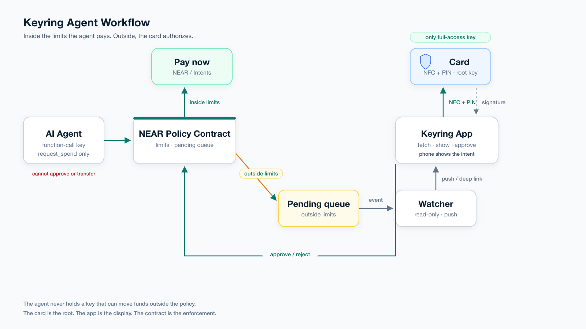

# Keyring Agent

**The agent spends. The card authorizes.**

An AI agent gets a scoped NEAR key and a spending policy. Inside the policy it pays on its own. Outside it, the payment is held, the iPhone shows the decoded request, and the Keyring card signs `approve` or `reject` over NFC.



## Why

Software-only agent wallets rely on the model, the prompt, or the host staying honest. A prompt-injected agent can ask for anything. This design makes the ask harmless:

- The agent holds a **function-call key** that can only call `request_spend`.
- The **contract** enforces a per-payment cap, a daily budget, and an allowlist; anything else waits in a bounded pending queue.
- The **card** is the account's only full-access key. Its signature is the authorization; the app is the display.

Even a fully compromised agent can only spend inside the envelope, and every over-limit attempt becomes a human decision with a hardware signature.

## Architecture

```
Agent ──request_spend──▶ NEAR policy contract
                            ├─ inside limits  → pay now
                            └─ outside limits → pending queue
                                                     │
                                              Read-only API
                                                     │ poll / push
                                                     ▼
                                         Keyring iOS app
                                          ├─ fetch pending from chain
                                          ├─ show amount / receiver / reason
                                          └─ NFC + PIN → card signs hash
                                                     │
                                                     ▼
                                         approve / reject → contract
```

The API is a message bus, not an authority:

- It reads the chain.
- It returns the nonce, block hash, and contract for an approval; the **app builds and hashes** the transaction itself.
- The app signs that hash with the card.
- The API broadcasts the signed transaction. It never sees the card key or the PIN.

## Repo layout

| Path | What |
|---|---|
| `contract/` | Rust `near-sdk` shared policy hub; 25 unit tests |
| `contract/artifacts/spend_policy.wasm` | Prebuilt wasm so the software-wallet test needs no Rust toolchain |
| `scripts/` | Software-wallet e2e, agent/card/deploy scripts |
| `api/` | Multi-user API: pairing, pending queue, unsigned tx preparation, broadcast |
| `ios-app/` | Native SwiftUI + CoreNFC approval app using the Keyring card |
| `mcp/` | Keyring MCP server exposed to any MCP agent |
| `packages/keyring-agent-skills/` | `npx keyring-agent-skills` installer: agent key, pairing, skill + MCP config |
| `skills/keyring-agent/` | Agent-agnostic skill (canonical) |
| `docs/workflow.png` | Architecture diagram |
| `spike/` | Original NEAR/card proof and command log |

## Quick start

> **Hardware availability.** The Keyring card is a hardware prototype. Its applet and the Swift
> card client are private, and the card is not publicly distributed. Reviewers can still run the
> entire policy flow with `npm test`: a local ed25519 **software approver** stands in for the card.
> The contract, key scoping, and limits are identical; only the NFC signature is swapped. The
> hardware flow below is documented for completeness and for the demo video.

### Verify without hardware (software wallet, ~1 minute)

You do **not** need the Keyring card or an iPhone to run the core flow. This uses a local NEAR
sandbox and software keys; the approver is a local ed25519 key standing in for the card.

```sh
npm install
npm test
```

Expected: `22/22 checks passed`. It deploys the committed wasm, creates accounts, gives the agent a
function-call key, and verifies:

- inside the policy → paid automatically (no approver)
- over the per-payment cap → held (`OverTxLimit`)
- unknown receiver → held (`NotAllowlisted`)
- the software approver approves one and rejects the other
- the agent key cannot `approve`, `set_policy`, or transfer NEAR
- the approver key cannot call `request_spend`

The first run downloads the NEAR sandbox binary (~50 MB). No testnet funds, no private applet repo,
no Rust toolchain (the wasm is committed at `contract/artifacts/spend_policy.wasm`).

Other checks:

```sh
npm run test:contract                # 25 contract tests (needs cargo)
sh ios-app/tests/near-tx/run.sh      # transaction-encoding golden vectors (needs swift)
```

What this does not cover: NFC/card applet, the iOS UI, and the hosted API. Those are the hardware
flow below.

### Agent onboarding (the product flow, needs the card)

Reviewers without hardware should use the software-wallet test above; this part needs the Keyring
card and an iPhone for NFC.

One command installs the capability, pairs the card account, and configures your agent:

```sh
# from this repo (the npm package is not published yet)
npx ./packages/keyring-agent-skills init

# after publishing:
# npx keyring-agent-skills init
```

It creates the agent's ed25519 key, prints a pairing code, and waits:

```
  Pairing code: BFE04D
  Link:         keyring-agent://pair?code=BFE04D
```

In the Keyring app, open **Pair agent** (Settings → Agent, or the first-run link screen) and enter
the code. The app shows the agent's public key and policy; approve with the card PIN and a tap. The
card signs two transactions:

1. `AddKey` on your account — the agent key is **function-call only**, limited to `request_spend`
   on the hub, with a small gas allowance.
2. `set_agent_key` on the hub — binds that key as the account's agent.

The CLI sees the pairing complete, writes `.keyring/config.json`, copies the skill into
`.opencode/skills/keyring-agent/`, registers the MCP server, and adds `.keyring/` to `.gitignore`.
Start a new agent session and say:

> init my keyring agent account

The agent calls `budget`, reports the account and policy, and is ready to pay. Agents other than
OpenCode: `--agent claude` writes `.mcp.json` and `~/.claude/skills/`; `--agent both` writes both;
`--agent print` prints the config to paste anywhere.

To let the agent drive the pairing instead, install only the skill:

```sh
npx keyring-agent-skills install
```

Open a new agent session and say **init my keyring agent account**. The agent runs
`init --no-wait --json`, shows you the code, waits while you approve in the app, then runs
`finish --code <code>`. Start another session to load the tools.

The agent key lives in `.keyring/agent-key.json` (mode 600, gitignored). The card key never leaves
the card.

### 1. Contract

```sh
cd contract
cargo test
```

The live shared hub is `keyring-policy-1105.testnet`. See `spike/COMMANDS.md` for deploys and transaction hashes.

### 2. API

From the repo root (it uses the root `node_modules`):

```sh
POLICY_ACCOUNT=keyring-policy-1105.testnet \
SPONSOR_ACCOUNT=keyring-sponsor-1105.testnet \
node api/server.mjs
```

The API is multi-user and needs no user account. Send the user's account per request:

```sh
curl -H 'X-User-Account: <card account>' http://127.0.0.1:8787/api/context
curl -H 'X-User-Account: <card account>' http://127.0.0.1:8787/api/pending
```

### 3. iOS app

```sh
cd ios-app
xcodegen generate
open KeyringAgent.xcodeproj
```

- Run on a **physical iPhone** for NFC.
- In the app, open **Settings** (gear icon) and set the API server to the Mac's LAN address, e.g. `http://192.168.1.20:8787`. Tap **Save and connect**; the choice is saved for the next launch.
- Set your development team in the target's Signing settings.

See `ios-app/README.md` for the card CA key, entitlement, and device notes. To prepare a dev card (install the applet, store its certificate), see `docs/card-setup.md`.

### 4. Repo-internal scripts (development)

The agent scripts act for one user, so they need that account:

```sh
export NEAR_ACCOUNT=<card account>
export POLICY_ACCOUNT=keyring-policy-1105.testnet

node scripts/agent.mjs spend vendor-a.testnet 0.1 "API credits"              # paid
node scripts/agent.mjs spend scam-wallet-1023.testnet 0.2 "poisoned invoice" # pending
node scripts/agent.mjs budget
```

If `API_URL` is reachable, `agent.mjs` posts the pending id and account to `/api/agent/notify`;
the API verifies it on-chain. The app polls, so the demo works without the notification.

## Security model

| Threat | Control |
|---|---|
| Prompt-injected agent tries an over-limit payment | Contract holds it; `OverTxLimit` / `NotAllowlisted` |
| Agent key stolen, tries a plain transfer | NEAR rejects it: `RequiresFullAccess` |
| Agent key stolen, tries `approve` or `set_policy` | NEAR rejects it: `MethodNameMismatch` |
| Guessed pairing code points an agent at another account | Pairing completes only after the API verifies that key is on-chain, function-call limited to the hub, and bound as the hub's agent key |
| User is tricked into approving an attacker's pairing code | The app shows the key and policy; card approval is the consent gate. Codes live in memory and expire with the API; compare the code with the CLI |
| Agent floods the pending queue | `MAX_PENDING = 32` (add expiry/pause next) |
| Malicious memo shown in the app | Rendered as untrusted text; amount/receiver come from contract state |
| API compromised | It can lie about the request, but the app rebuilds the transaction and the card signs with the account's approver key; consider a scoped approval key for production |

## Known limitations / next

- The card is a prototype: the applet and Swift client are private, and there is no public card
  distribution. The public reviewer path uses a software approver (`npm test`).
- Pairing sessions are in memory; an API restart invalidates outstanding codes (re-run `init`).
- No APNs push yet; the app polls while active and supports deep links (`keyring-agent://approve?...` and `keyring-agent://pair?code=...`). Add universal links and APNs next.
- The app pins the applet's **test CA** public key. Replace it with the production CA for a production-personalized card.
- The app depends on the private `KeyringCardClient` Swift package at `../near-hackthon-applets/client-swift`; it is not published. Replace it with the published client for a public build.
- Contract pause/expiry/`reject_all` are the next hardening step.

## Status

- Contract tests: 25/25 passing.
- Hardware-free software-wallet e2e: `npm test` → 22/22 checks on a local NEAR sandbox.
- Testnet code hash matches the local wasm for `keyring-policy-1105.testnet`.
- Reject path verified end-to-end: API prepare → card-format signature → broadcast → `spend_rejected` on testnet.
- Agent onboarding verified end-to-end with the software card: agent key → pairing code → `AddKey` + `set_agent_key` → CLI config → packaged MCP pays inside the policy.
- The app's pairing screens build and are encoded against the NEAR SDK (`AddKey` golden vector); hardware NFC test is the remaining step.
